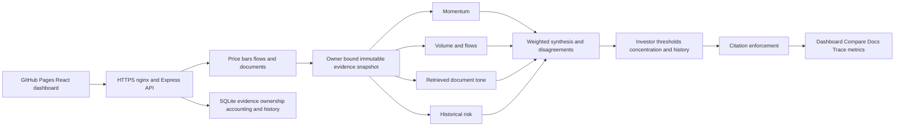

# VibeFinance architecture and decision logic

VibeFinance is anonymous retail-investor research software. It combines four concurrent analytical agents, document retrieval, cited explanations and example investor risk rules. It does not trade or provide a validated return forecast.

## Agent and AI responsibilities

Each agent returns a validated contract: role, ticker, cut-off, classification, score, evidence confidence, claims/citations, features, latency and degradation status. Momentum uses returns, moving averages and RSI; volume uses anomalies and available institutional flows; sentiment scores retrieved passages using a financial lexicon and recency; risk uses historical volatility, drawdown and comparison-basket beta.

Four agents execute through `Promise.allSettled`. Individual deadlines turn failed specialists into insufficient evidence without losing all results. Admission, total deadlines, cancellation, bounded queues and source circuit breakers constrain work. Quota exhaustion is propagated as an error, not disguised as successful model reasoning.

Signal arithmetic, weights and personalization are deterministic. The optional LLM receives verified sentences and citation indices. Changed or unsupported facts are rejected in favor of the verified fallback. This is intentionally constrained decision support, not an autonomous research planner. Demo uses mock models and no paid API calls.

## Retrieval and attribution

Documents are chunked and encoded into local 512-dimensional hashed token/bigram vectors. Cosine similarity plus financial-keyword boosts ranks passages, with instrument and analysis-date filters. This is lightweight lexical-vector retrieval, not learned semantic embeddings or a hosted vector database. Passages ground sentiment and are openable through citations. Numeric claims cite actual measurements.

Demo filings/transcripts are explicitly synthetic teaching documents. Live sources include daily Yahoo observations and available NSE RSS/GDELT summaries, not full transcripts. Imported NSE FII/DII data is market-wide, not company/sector flow evidence. Source dates and retrieval timestamps are distinct; unknown dates are disclosed and undated summaries are excluded from recency-weighted sentiment. Missing filings are not invented.

## Synthesis and personalization

Effective weight is configured weight times agent confidence; insufficient-evidence agents have zero weight. Composite score is weighted score sum divided by effective weight sum. Low aggregate evidence yields insufficient evidence. Opposing scores above 0.3 in absolute magnitude generate explicit disagreements. Evidence confidence combines strength, coverage and agreement. It is not a profit probability. Legacy upward-return calibration bins are preserved but never applied to confidence; no statistical uncertainty interval is claimed.

Three SQLite-stored example profiles contain risk tolerance, volatility ceiling, holdings and behavioral tendencies. Conservative thresholds are stricter and disagreements prevent conservative additions. Sizing is constrained by volatility/concentration checks. These are illustrative scenarios, not verified personal holdings or a suitability assessment. Compare shares frozen evidence across profiles and recalculates personalization. Its stored trace represents the final profile's personalization; cards retain each profile's result.

## Data modes and persistence

Explicit Live requests use real-source or cached evidence, never silently synthetic prices. If neither source is usable, an unavailable response is correct. Explicit Demo uses the seeded generator. Offline bundled Demo supports INFY/Rohan only, with frozen synthetic source coverage. Older saved results without coverage metadata are explicitly disclosed.

New analyses persist versioned SHA-256-hashed evidence snapshots bound to signed anonymous visitor capabilities. Charts and document citations resolve the owned snapshot. SQLite stores runs, decisions, traces, evidence, usage, spending and reset audits. Journal notes/watchlist preferences remain browser-local. Versioned migrations are transactional. Historical overwritten runs or untrusted old ownership cannot be safely reconstructed.

## Evaluation and operations

First visits default to clearly labelled Demo; a remembered Live selection is respected. Current-analysis metrics distinguish the browser analysis-request duration (including identity/network overhead, excluding page/chart loading) from the matching server trace span. Session aggregates and single-session accuracy/Brier are not presented as current-run performance. The Eval page remains the published benchmark.

Seed fixture version 2 adds repeatable positive and negative sessions to the INFY/SBIN teaching trends. The transactional fixture upgrade updates only generated SYNTHETIC seed bars, retaining Live/cached rows, profiles, immutable snapshots, history and quota/spending/reset audits. It does not reseed the production database. Older frozen results retain their original evidence. The risk card labels volatility relative to its 25% reference, not expected upside; the numeric weighting rules are unchanged.

Session metrics include measured elapsed latency, example-portfolio HHI and evidence coverage. Fixture accuracy/Brier require synthetic future labels; Live predictions are not evaluated using synthetic outcomes. Published reports record source/data hashes, seed, configuration, chronological windows, abstentions and paired baselines. The synthetic last-30% window follows a 30-session purge. The runner fits no thresholds or calibration. Designed scenarios and overlapping labels limit generalization. Repeated local mock-engine timing is not field or HTTP performance.

GitHub Pages hosts React. Nginx proxies HTTPS to loopback Express under a restricted systemd service. Deployments back up SQLite, dependencies and compiled code before health-checked restarts. Backups and monitoring remain on the VPS; offsite backups and external alerts are deferred by user choice. Admin retains Basic authentication over HTTPS. Signed visitor/per-network/global call limits and a separate estimated USD budget constrain model use, not provider-wide billing.

Flags: x1 sources/snapshots, x2 search, x3 local alert records, x4 evaluation, x6 history, x7 shared preparation. x5 remains accepted for compatibility but does not enable retired calibration behavior.
